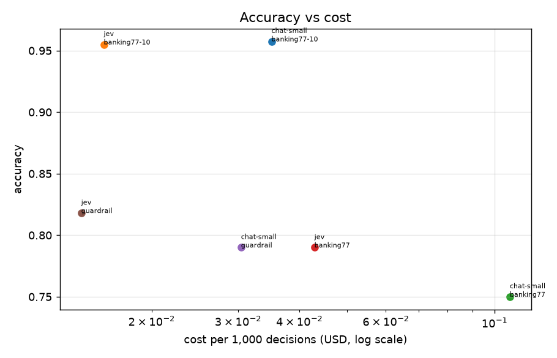
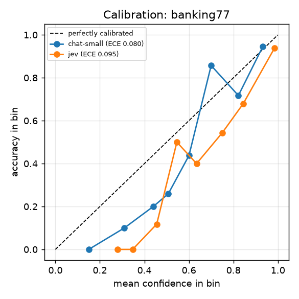
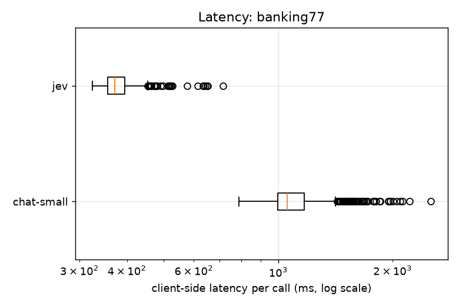
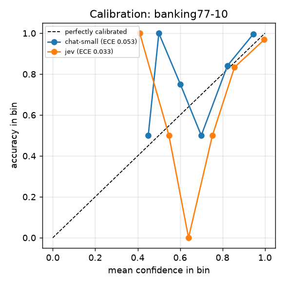
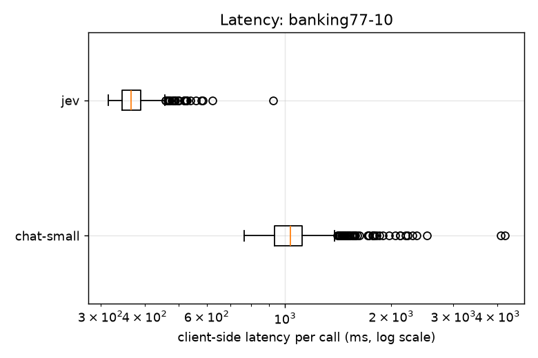
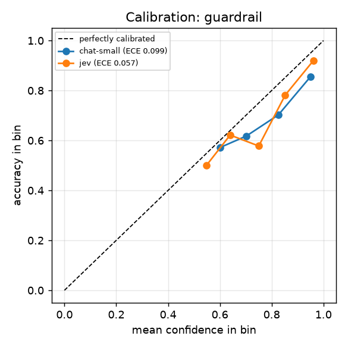
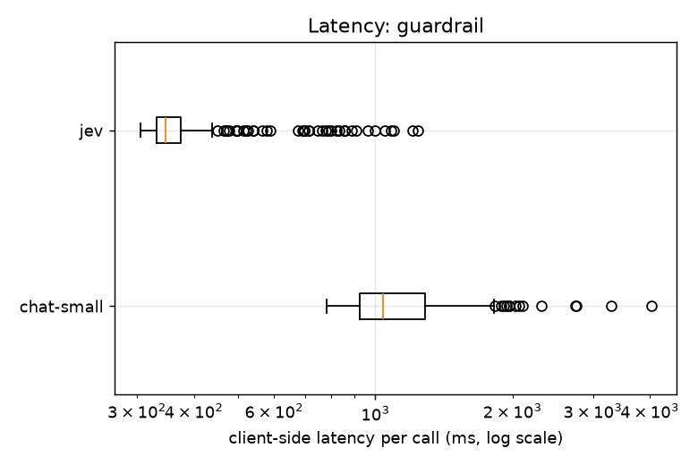
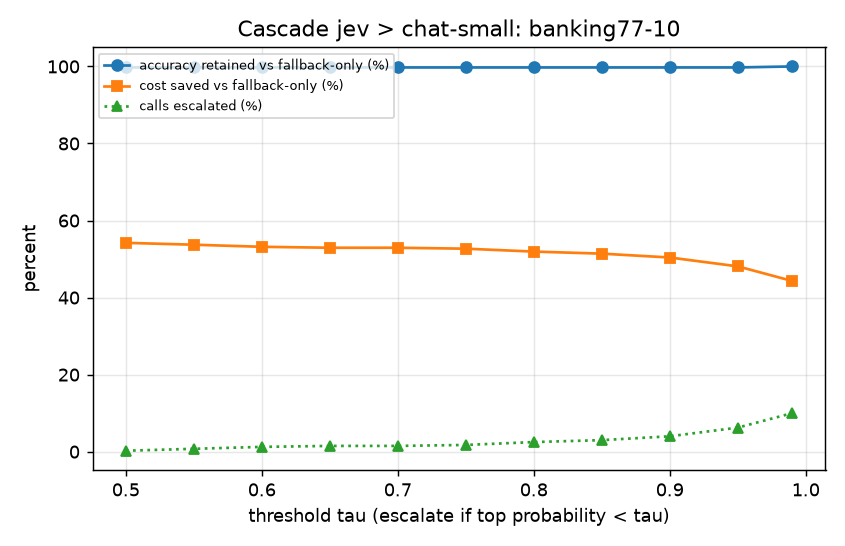
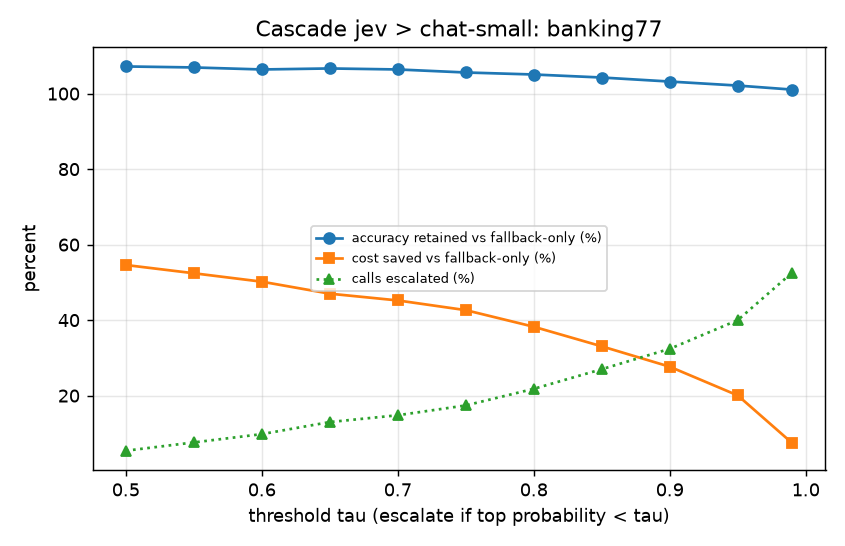
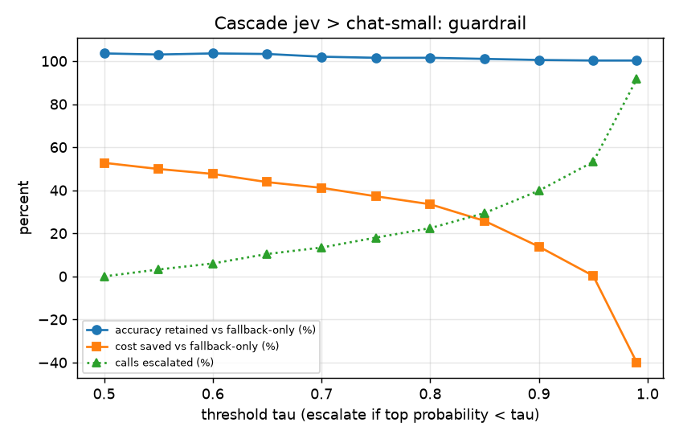

# system-one-decision-bench report

- Run date(s): 2026-10-22
- Git: uncommitted
- Methodology: fixed seed and sample, identical inputs to every backend, warm-up calls excluded from latency, latency measured client-side with network included at concurrency 4 (calls in flight), failed or unparseable calls count as wrong and are reported separately, accuracy CIs are 95% percentile bootstrap.

Cost columns are token usage x list price (not measured spend): chat-small (claude-haiku-5-5): $0.1 in / $0.5 out per million tokens, list price on 2026-10-22 (https://platform.claude.com/docs/en/about-claude/pricing); jev (jev): $0.042 in / $0.0 out per million tokens, list price on 2026-10-22 (Jev list price from the vendor's published documentation, retrieved 2026-10-22.).

- **Chat baseline configuration: claude-haiku-5-5, thinking disabled, max_tokens=128.** Thinking is disabled, which is **not Haiku 5.5's default behaviour** (default: adaptive thinking on). In an initial smoke test with thinking on and this token budget, a substantial share of calls spent all their tokens on thinking and returned no answer.

## Vendor claims vs what we measured

| | Vendor-reported | Measured here (Jev rows, this run) |
|---|---|---|
| Latency (p50 / p95) | 70-500 ms end to end (reported by third-party write-ups; Jev's own docs give no latency figure) | banking77-10: 367 / 485 ms, banking77: 372 / 463 ms, guardrail: 346 / 677 ms |
| Cost per 1,000 decisions | $0.042 per million input tokens, output free (Jev docs, models page, retrieved 2026-10-22) | banking77-10: $0.0160, banking77: $0.0429, guardrail: $0.0144 |

## Summary: Jev alone, fallback alone, cascade

Threshold rules are fixed in advance: **max accuracy** (ties: cheaper) and **cheapest acceptable** (lowest list-price cost among thresholds within 1 percentage point of fallback-only accuracy). Cascade accuracy CIs are 95% percentile bootstrap over examples.

| task | fallback | Jev acc [CI] | fallback acc [CI] | cascade, max accuracy: acc [CI] (tau) | cascade, cheapest acceptable: acc [CI] (tau) | ECE Jev | ECE fallback | fallback failure rate (invalid / API error) |
|---|---|---|---|---|---|---|---|---|
| banking77 | chat-small | 0.790 [0.754, 0.822] | 0.750 [0.712, 0.786] | 0.804 [0.770, 0.838] (tau 0.50) | 0.804 [0.770, 0.838] (tau 0.50) | 0.095 | 0.080 | 0.000 (0.000 / 0.000) |
| banking77-10 | chat-small | 0.955 [0.935, 0.973] | 0.958 [0.938, 0.975] | 0.958 [0.938, 0.975] (tau 0.99) | 0.955 [0.935, 0.973] (tau 0.50) | 0.033 | 0.053 | 0.000 (0.000 / 0.000) |
| guardrail | chat-small | 0.818 [0.780, 0.852] | 0.790 [0.754, 0.826] | 0.818 [0.780, 0.852] (tau 0.50) | 0.818 [0.780, 0.852] (tau 0.50) | 0.057 | 0.099 | 0.004 (0.004 / 0.000) |

Cost is list price on the retrieval date above, not measured spend. Latency is measured client-side; an escalated call pays Jev's latency plus the fallback's.

| task | fallback | rule | tau | escalated % | $/1k cascade vs fallback-only | p50 / p95 ms cascade vs fallback-only | acc minus fallback-only [95% CI] | acc minus Jev-only [95% CI] | cost vs Jev-only |
|---|---|---|---|---|---|---|---|---|---|
| banking77 | chat-small | max accuracy | 0.50 | 5.4 | $0.0487 vs $0.1073 (0.454x) | 374 / 1274 vs 1057 / 1634 | +0.054 [+0.028, +0.082] | +0.014 [+0.004, +0.026] | 1.135x |
| banking77 | chat-small | cheapest acceptable | 0.50 | 5.4 | $0.0487 vs $0.1073 (0.454x) | 374 / 1274 vs 1057 / 1634 | +0.054 [+0.028, +0.082] | +0.014 [+0.004, +0.026] | 1.135x |
| banking77-10 | chat-small | max accuracy | 0.99 | 10.0 | $0.0195 vs $0.0351 (0.557x) | 371 / 1336 vs 1035 / 1713 | +0.000 [-0.007, +0.007] | +0.003 [-0.007, +0.013] | 1.223x |
| banking77-10 | chat-small | cheapest acceptable | 0.50 | 0.2 | $0.0161 vs $0.0351 (0.458x) | 367 / 486 vs 1035 / 1713 | -0.003 [-0.015, +0.010] | +0.000 [+0.000, +0.000] | 1.005x |
| guardrail | chat-small | max accuracy | 0.50 | 0.0 | $0.0144 vs $0.0304 (0.473x) | 346 / 677 vs 1037 / 1679 | +0.028 [-0.000, +0.058] | +0.000 [+0.000, +0.000] | 1.000x |
| guardrail | chat-small | cheapest acceptable | 0.50 | 0.0 | $0.0144 vs $0.0304 (0.473x) | 346 / 677 vs 1037 / 1679 | +0.028 [-0.000, +0.058] | +0.000 [+0.000, +0.000] | 1.000x |

- **banking77**: at tau 0.50 (5.4% escalated) the cascade costs 0.454x the chat-small-only baseline at list price; accuracy difference vs fallback-only +0.054 [+0.028, +0.082]. Against Jev alone it adds +0.014 accuracy [+0.004, +0.026] at 1.135x Jev's cost.
- **banking77-10**: at tau 0.50 (0.2% escalated) the cascade costs 0.458x the chat-small-only baseline at list price; accuracy difference vs fallback-only -0.003 [-0.015, +0.010]. Against Jev alone it adds +0.000 accuracy [+0.000, +0.000] at 1.005x Jev's cost: **no measurable accuracy gain over Jev alone**, so the saving versus the fallback comes from Jev itself, not from the cascade.
- **guardrail**: at tau 0.50 (0.0% escalated) the cascade costs 0.473x the chat-small-only baseline at list price; accuracy difference vs fallback-only +0.028 [-0.000, +0.058]. Against Jev alone it adds +0.000 accuracy [+0.000, +0.000] at 1.000x Jev's cost: **no measurable accuracy gain over Jev alone**, so the saving versus the fallback comes from Jev itself, not from the cascade.

## Paired comparison: Jev vs chat-small on the same example ids

Accuracy difference is Jev minus chat-small (paired percentile bootstrap, 95% CI). McNemar is the exact two-sided test on the discordant pairs (one model right, the other wrong). Failed calls count as wrong. Three tasks were tested with no multiplicity correction. Latency ratio is measured p95 / p50 per backend (tail heaviness).

| task | n | both right | only Jev right | only chat-small right | both wrong | acc Jev minus chat-small [95% CI] | McNemar exact p | Jev p95/p50 | chat-small p95/p50 |
|---|---|---|---|---|---|---|---|---|---|
| banking77 | 500 | 357 | 38 | 18 | 87 | +0.040 [+0.014, +0.070] | 0.0105 | 1.24 | 1.55 |
| banking77-10 | 400 | 379 | 3 | 4 | 14 | -0.003 [-0.015, +0.010] | 1.0000 | 1.32 | 1.66 |
| guardrail | 500 | 374 | 35 | 21 | 70 | +0.028 [-0.000, +0.058] | 0.0814 | 1.96 | 1.62 |

## Accuracy by class count: banking77-10 vs banking77

| backend | 10 classes | 77 classes | difference |
|---|---|---|---|
| chat-small | 0.958 [0.938, 0.975] (n=400) | 0.750 [0.712, 0.786] (n=500) | +0.208 |
| jev | 0.955 [0.935, 0.973] (n=400) | 0.790 [0.754, 0.822] (n=500) | +0.165 |

Caveat: the 10 classes are hand-picked and the example sets differ, so this is a comparison of two tasks, not a controlled test of class count alone.

## banking77

Source: https://huggingface.co/datasets/legacy-datasets/banking77 (mirror of PolyAI/banking77) (CC-BY-4.0). n = 500, seed 0. Dataset revision: f54121560de48f2852f90be299010d1d6dc612ec.

| backend | resolved model id | acc [95% CI] | macro-F1 | ECE | p50 / p95 / p99 ms (measured) | $/1k (list price) | invalid | error |
|---|---|---|---|---|---|---|---|---|
| chat-small | claude-haiku-5-5 | 0.750 [0.712, 0.786] | 0.725 | 0.080 | 1057 / 1634 / 2008 | 0.1073 | 0.000 | 0.000 |
| jev | jev-1.13.0 | 0.790 [0.754, 0.822] | 0.765 | 0.095 | 372 / 463 / 634 | 0.0429 | 0.000 | 0.000 |

Highest accuracy among real backends on this task: **jev** (0.790).

 

Reliability data, chat-small (ECE 0.080):

| confidence bin | n | mean confidence | accuracy |
|---|---|---|---|
| 0.1-0.2 | 1 | 0.150 | 0.000 |
| 0.3-0.4 | 10 | 0.310 | 0.100 |
| 0.4-0.5 | 5 | 0.440 | 0.200 |
| 0.5-0.6 | 27 | 0.507 | 0.259 |
| 0.6-0.7 | 64 | 0.600 | 0.438 |
| 0.7-0.8 | 7 | 0.700 | 0.857 |
| 0.8-0.9 | 145 | 0.822 | 0.717 |
| 0.9-1.0 | 241 | 0.932 | 0.946 |

Reliability data, jev (ECE 0.095):

| confidence bin | n | mean confidence | accuracy |
|---|---|---|---|
| 0.2-0.3 | 3 | 0.280 | 0.000 |
| 0.3-0.4 | 7 | 0.347 | 0.000 |
| 0.4-0.5 | 17 | 0.455 | 0.118 |
| 0.5-0.6 | 22 | 0.546 | 0.500 |
| 0.6-0.7 | 25 | 0.634 | 0.400 |
| 0.7-0.8 | 35 | 0.749 | 0.543 |
| 0.8-0.9 | 53 | 0.844 | 0.679 |
| 0.9-1.0 | 338 | 0.984 | 0.938 |

Where chat-small is wrong (125 of 500; failed calls count as wrong):

- `order_physical_card`: 9 of 10 wrong, most often predicted as `get_physical_card`.
- `declined_card_payment`: 7 of 8 wrong, most often predicted as `card_not_working`.
- `top_up_by_bank_transfer_charge`: 7 of 9 wrong, most often predicted as `transfer_fee_charged`.

Where jev is wrong (105 of 500; failed calls count as wrong):

- `order_physical_card`: 10 of 10 wrong, most often predicted as `get_physical_card`.
- `top_up_by_bank_transfer_charge`: 7 of 9 wrong, most often predicted as `transfer_fee_charged`.
- `get_physical_card`: 5 of 5 wrong, most often predicted as `change_pin`.

## banking77-10

Source: https://huggingface.co/datasets/legacy-datasets/banking77 (10-class subset; mirror of PolyAI/banking77) (CC-BY-4.0). n = 400, seed 0. Dataset revision: f54121560de48f2852f90be299010d1d6dc612ec.

| backend | resolved model id | acc [95% CI] | macro-F1 | ECE | p50 / p95 / p99 ms (measured) | $/1k (list price) | invalid | error |
|---|---|---|---|---|---|---|---|---|
| chat-small | claude-haiku-5-5 | 0.958 [0.938, 0.975] | 0.956 | 0.053 | 1035 / 1713 / 2302 | 0.0351 | 0.000 | 0.000 |
| jev | jev-1.13.0 | 0.955 [0.935, 0.973] | 0.954 | 0.033 | 367 / 485 / 560 | 0.0160 | 0.000 | 0.000 |

Highest accuracy among real backends on this task: **chat-small** (0.958).

 

Reliability data, chat-small (ECE 0.053):

| confidence bin | n | mean confidence | accuracy |
|---|---|---|---|
| 0.4-0.5 | 2 | 0.450 | 0.500 |
| 0.5-0.6 | 3 | 0.500 | 1.000 |
| 0.6-0.7 | 12 | 0.602 | 0.750 |
| 0.7-0.8 | 4 | 0.700 | 0.500 |
| 0.8-0.9 | 63 | 0.823 | 0.841 |
| 0.9-1.0 | 316 | 0.946 | 0.997 |

Reliability data, jev (ECE 0.033):

| confidence bin | n | mean confidence | accuracy |
|---|---|---|---|
| 0.4-0.5 | 1 | 0.410 | 1.000 |
| 0.5-0.6 | 4 | 0.547 | 0.500 |
| 0.6-0.7 | 1 | 0.640 | 0.000 |
| 0.7-0.8 | 4 | 0.752 | 0.500 |
| 0.8-0.9 | 6 | 0.857 | 0.833 |
| 0.9-1.0 | 384 | 0.997 | 0.969 |

Where chat-small is wrong (17 of 400; failed calls count as wrong):

- `transfer_not_received_by_recipient`: 16 of 40 wrong, most often predicted as `pending_transfer`.
- `top_up_failed`: 1 of 40 wrong, most often predicted as `card_not_working`.

Where jev is wrong (18 of 400; failed calls count as wrong):

- `transfer_not_received_by_recipient`: 13 of 40 wrong, most often predicted as `pending_transfer`.
- `pending_transfer`: 2 of 40 wrong, most often predicted as `transfer_not_received_by_recipient`.
- `card_arrival`: 1 of 40 wrong, most often predicted as `lost_or_stolen_card`.

## guardrail

Source: https://huggingface.co/datasets/nvidia/Aegis-AI-Content-Safety-Dataset-2.0 (CC-BY-4.0). n = 500, seed 0. Dataset revision: d86bb8bedff51d25ac834ab7838f1cc61acb7a2c.

| backend | resolved model id | acc [95% CI] | macro-F1 | ECE | p50 / p95 / p99 ms (measured) | $/1k (list price) | invalid | error |
|---|---|---|---|---|---|---|---|---|
| chat-small | claude-haiku-5-5 | 0.790 [0.754, 0.826] | 0.790 | 0.099 | 1037 / 1679 / 2105 | 0.0304 | 0.004 | 0.000 |
| jev | jev-1.13.0 | 0.818 [0.780, 0.852] | 0.817 | 0.057 | 346 / 677 / 999 | 0.0144 | 0.000 | 0.000 |

Highest accuracy among real backends on this task: **jev** (0.818).

 

Reliability data, chat-small (ECE 0.099):

| confidence bin | n | mean confidence | accuracy |
|---|---|---|---|
| 0.6-0.7 | 14 | 0.600 | 0.571 |
| 0.7-0.8 | 34 | 0.702 | 0.618 |
| 0.8-0.9 | 121 | 0.826 | 0.702 |
| 0.9-1.0 | 329 | 0.949 | 0.854 |

Reliability data, jev (ECE 0.057):

| confidence bin | n | mean confidence | accuracy |
|---|---|---|---|
| 0.5-0.6 | 30 | 0.548 | 0.500 |
| 0.6-0.7 | 37 | 0.640 | 0.622 |
| 0.7-0.8 | 45 | 0.750 | 0.578 |
| 0.8-0.9 | 87 | 0.852 | 0.782 |
| 0.9-1.0 | 301 | 0.962 | 0.920 |

Where chat-small is wrong (105 of 500; failed calls count as wrong):

- Missed unsafe: 71; false alarms on safe: 34.
- Violated categories most often wrong (wrong of total, a message can have several): Needs Caution (23 of 62); Criminal Planning/Confessions (20 of 147); Profanity (12 of 31).

Where jev is wrong (91 of 500; failed calls count as wrong):

- Missed unsafe: 62; false alarms on safe: 29.
- Violated categories most often wrong (wrong of total, a message can have several): Needs Caution (18 of 62); Criminal Planning/Confessions (14 of 147); Sexual (9 of 29).

## Cascade: jev > chat-small on banking77-10

Primary only: accuracy 0.955, $0.0160/1k. Fallback only: accuracy 0.958, $0.0351/1k.

| tau | accuracy [95% CI] | acc minus fallback-only [95% CI] | escalated % | fallback failed on escalated | $/1k (list price) | cost vs fallback | p50 ms | p95 ms |
|---|---|---|---|---|---|---|---|---|
| 0.50 | 0.955 [0.935, 0.973] | -0.003 [-0.015, +0.010] | 0.2 | 0 | 0.0161 | 0.458 | 367 | 486 |
| 0.55 | 0.955 [0.935, 0.973] | -0.003 [-0.013, +0.007] | 0.8 | 0 | 0.0162 | 0.463 | 367 | 489 |
| 0.60 | 0.955 [0.935, 0.973] | -0.003 [-0.013, +0.007] | 1.2 | 0 | 0.0164 | 0.468 | 367 | 498 |
| 0.65 | 0.955 [0.935, 0.973] | -0.003 [-0.013, +0.007] | 1.5 | 0 | 0.0165 | 0.471 | 367 | 499 |
| 0.70 | 0.955 [0.935, 0.973] | -0.003 [-0.013, +0.007] | 1.5 | 0 | 0.0165 | 0.471 | 367 | 499 |
| 0.75 | 0.955 [0.935, 0.973] | -0.003 [-0.013, +0.007] | 1.8 | 0 | 0.0166 | 0.473 | 367 | 500 |
| 0.80 | 0.955 [0.935, 0.973] | -0.003 [-0.013, +0.007] | 2.5 | 0 | 0.0169 | 0.481 | 368 | 521 |
| 0.85 | 0.955 [0.935, 0.973] | -0.003 [-0.013, +0.007] | 3.0 | 0 | 0.0171 | 0.486 | 368 | 524 |
| 0.90 | 0.955 [0.935, 0.975] | -0.003 [-0.010, +0.005] | 4.0 | 0 | 0.0174 | 0.496 | 369 | 561 |
| 0.95 | 0.955 [0.935, 0.975] | -0.003 [-0.010, +0.005] | 6.2 | 0 | 0.0182 | 0.519 | 369 | 1254 |
| 0.99 | 0.958 [0.938, 0.975] | +0.000 [-0.007, +0.007] | 10.0 | 0 | 0.0195 | 0.557 | 371 | 1336 |

## Cascade: jev > chat-small on banking77

Primary only: accuracy 0.790, $0.0429/1k. Fallback only: accuracy 0.750, $0.1073/1k.

| tau | accuracy [95% CI] | acc minus fallback-only [95% CI] | escalated % | fallback failed on escalated | $/1k (list price) | cost vs fallback | p50 ms | p95 ms |
|---|---|---|---|---|---|---|---|---|
| 0.50 | 0.804 [0.770, 0.838] | +0.054 [+0.028, +0.082] | 5.4 | 0 | 0.0487 | 0.454 | 374 | 1274 |
| 0.55 | 0.802 [0.766, 0.836] | +0.052 [+0.028, +0.080] | 7.6 | 0 | 0.0511 | 0.476 | 374 | 1419 |
| 0.60 | 0.798 [0.762, 0.830] | +0.048 [+0.024, +0.074] | 9.8 | 0 | 0.0535 | 0.498 | 376 | 1477 |
| 0.65 | 0.800 [0.764, 0.834] | +0.050 [+0.028, +0.076] | 13.0 | 0 | 0.0569 | 0.530 | 377 | 1530 |
| 0.70 | 0.798 [0.760, 0.832] | +0.048 [+0.026, +0.074] | 14.8 | 0 | 0.0588 | 0.548 | 377 | 1534 |
| 0.75 | 0.792 [0.756, 0.826] | +0.042 [+0.020, +0.068] | 17.4 | 0 | 0.0616 | 0.574 | 379 | 1546 |
| 0.80 | 0.788 [0.750, 0.820] | +0.038 [+0.018, +0.060] | 21.8 | 0 | 0.0663 | 0.618 | 381 | 1560 |
| 0.85 | 0.782 [0.744, 0.814] | +0.032 [+0.014, +0.050] | 27.0 | 0 | 0.0719 | 0.669 | 384 | 1644 |
| 0.90 | 0.774 [0.736, 0.808] | +0.024 [+0.010, +0.040] | 32.4 | 0 | 0.0777 | 0.723 | 389 | 1700 |
| 0.95 | 0.766 [0.728, 0.802] | +0.016 [+0.004, +0.030] | 40.0 | 0 | 0.0858 | 0.800 | 414 | 1868 |
| 0.99 | 0.758 [0.720, 0.794] | +0.008 [-0.002, +0.018] | 52.6 | 0 | 0.0994 | 0.926 | 1289 | 1923 |

## Cascade: jev > chat-small on guardrail

Primary only: accuracy 0.818, $0.0144/1k. Fallback only: accuracy 0.790, $0.0304/1k.

| tau | accuracy [95% CI] | acc minus fallback-only [95% CI] | escalated % | fallback failed on escalated | $/1k (list price) | cost vs fallback | p50 ms | p95 ms |
|---|---|---|---|---|---|---|---|---|
| 0.50 | 0.818 [0.780, 0.852] | +0.028 [-0.000, +0.058] | 0.0 | 0 | 0.0144 | 0.473 | 346 | 677 |
| 0.55 | 0.814 [0.774, 0.848] | +0.024 [-0.002, +0.052] | 3.2 | 0 | 0.0152 | 0.501 | 348 | 859 |
| 0.60 | 0.818 [0.778, 0.850] | +0.028 [+0.002, +0.054] | 6.0 | 0 | 0.0159 | 0.524 | 349 | 1260 |
| 0.65 | 0.816 [0.778, 0.850] | +0.026 [+0.004, +0.048] | 10.4 | 0 | 0.0171 | 0.562 | 352 | 1425 |
| 0.70 | 0.806 [0.768, 0.838] | +0.016 [-0.006, +0.038] | 13.4 | 0 | 0.0179 | 0.589 | 353 | 1507 |
| 0.75 | 0.802 [0.764, 0.836] | +0.012 [-0.006, +0.030] | 18.0 | 0 | 0.0191 | 0.628 | 359 | 1673 |
| 0.80 | 0.802 [0.764, 0.838] | +0.012 [-0.004, +0.028] | 22.4 | 0 | 0.0202 | 0.665 | 365 | 1716 |
| 0.85 | 0.798 [0.760, 0.834] | +0.008 [-0.004, +0.022] | 29.4 | 0 | 0.0226 | 0.742 | 372 | 1765 |
| 0.90 | 0.794 [0.756, 0.832] | +0.004 [-0.006, +0.016] | 39.8 | 1 | 0.0262 | 0.862 | 392 | 1833 |
| 0.95 | 0.792 [0.756, 0.826] | +0.002 [+0.000, +0.006] | 53.2 | 1 | 0.0304 | 0.997 | 1204 | 1932 |
| 0.99 | 0.792 [0.756, 0.826] | +0.002 [+0.000, +0.006] | 91.6 | 2 | 0.0426 | 1.399 | 1383 | 2074 |

## Limitations

- Jev is a hosted, early-access model; this is a snapshot on the run date, not a permanent property of the model.
- Calibration: ECE is reported as measured, with no confidence interval, from 400-500 examples and 10 equal-width bins. This report does not claim that either model is better calibrated.
- The cascade was tested only with a fallback that is no more accurate than Jev, so its results say nothing about cascades with a stronger fallback.
- Chat-model probabilities are *verbalised* confidences, not token probabilities, so their calibration is not comparable like-for-like with Jev's.
- Cost is token usage x list price (config/prices.yaml); it ignores batch discounts, caching and volume terms.
- Samples are capped (default 500 per task); intervals show the resulting uncertainty.
- The best thresholds are picked on the same examples they are measured on, so the best-threshold accuracy and any gain over Jev alone are optimistic; the CIs do not account for choosing among several thresholds.
- The cascade is replayed offline from two cached runs; an escalated call is charged both calls' cost and latency. If the fallback call fails or returns invalid output, the cascade keeps Jev's answer and the failure is counted separately.
- Chat baseline request settings: chat-small: claude-haiku-5-5, thinking disabled, max_tokens=128. A call that runs out of tokens is an invalid output and is counted as a failure.

## Not tested

- The cascade was tested only with a fallback that is no more accurate than Jev (on this run chat-small is lower on banking77, a clear gap in the paired comparison, and within noise on banking77-10 and guardrail), so it says nothing about cascades with a stronger fallback.
- Frontier models were not benchmarked. The only chat model here is a small one, so a cascade win against it says nothing about a frontier fallback.
- Gateways other than direct HTTP (LiteLLM, Vercel AI Gateway, Portkey, TrueFoundry, Requesty/OpenRouter, Arize) were not tested live.
- Results are a snapshot on the run date with pinned model IDs (config/models.yaml); a different model version or day can give different numbers.
